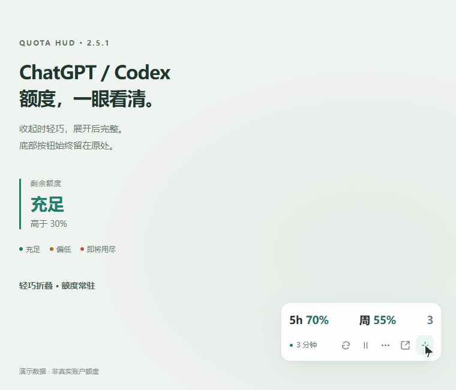

# ChatGPT/Codex 额度悬浮窗

在 ChatGPT/Codex 网页右下角查看 5h 额度、周额度、恢复时间和可用 Reset 次数。支持拖动、平滑展开/折叠，以及自定义自动刷新间隔。

**[安装最新脚本](https://raw.githubusercontent.com/wrrsesais/chatgpt-codex-quota-hud/main/chatgpt-quota.user.js)** · [反馈问题](https://github.com/wrrsesais/chatgpt-codex-quota-hud/issues) · [更新记录](CHANGELOG.md)

*演示数据：绿色（高于 30%）、黄色（10%–30%）、红色（低于 10%）。详情向上展开，底部按钮保持原位。* [查看静态预览](quota-demo-poster.png)

## 安装和使用

1. 安装支持页面上下文注入的用户脚本管理器，例如 Tampermonkey。
2. 点击上面的安装链接，确认安装脚本。
3. 刷新 ChatGPT 网页，打开一次官方额度页：<https://chatgpt.com/settings/usage?tab=overview>。
4. 等待识别完成，即可在悬浮窗查看数据。点击 `− / ＋` 收起或展开，拖动标题或底部空白区域可移动位置。

已有旧版时，请更新原脚本条目，避免同时启用多个版本。界面为中文，仅在 `https://chatgpt.com/*` 运行，不用于桌面端、CLI 或 API 计费控制台。

## 功能

- 折叠时显示 `5h xx%　周 xx%　Reset 数字`，可用次数以紫色数字显示；悬停可查看说明。
- 详情向上展开，底部的刷新、暂停、更多、官方页面和展开按钮保持原位。
- 按**剩余额度**着色：低于 10% 红色，10%–30% 黄色，高于 30% 绿色。0% 显示“已用尽”，未知或冲突的数值显示 `—`。
- 自动适配深浅色主题，支持键盘操作和系统“减少动态效果”设置。
- 默认约 3 分钟刷新一次。在 `⋯ → 刷新间隔` 中可选择 1、3、5、10 分钟，或自定义 0.5–60 分钟。
- 隐藏标签页暂停自动请求；手动刷新有防连点限制；遇到服务器限流会等待后重试。
- 保存窗口位置、折叠状态和刷新偏好。满足当前身份及工作区校验条件时，可恢复本标签页先前识别的接口并重新获取数据。
- 提供清除识别、重置位置和脱敏诊断导出。

## 数据来源和隐私

脚本观察当前页面符合条件的同源额度 GET 请求，并读取额度面板作为后备。为了重放已识别的只读请求，会在内存中暂存该页面请求中的 Bearer 和工作区信息。

- 不向第三方服务器发送数据，不远程加载可执行代码。
- 不将 Bearer、额度正文或聊天正文保存到持久存储。
- 本地设置只保存界面偏好；本标签页缓存只保存经过筛选的接口路径、请求凭据模式、身份/工作区摘要和过期时间，不保存原始账户标识。
- DOM 读取范围限定在额度页或选中的额度面板。
- 诊断导出只包含脱敏后的字段结构和识别状态，不包含字段值、凭据、账户标识、接口地址或页面摘录。
- 不会自动点击 Reset，也不会把倒计时归零直接当作额度已经恢复。

## 使用限制

这是一份非官方用户脚本，依赖网站页面和私有接口结构。不同套餐、工作区、语言或网站更新可能影响识别；不能保证所有额度字段都能获取。

首次通常需要手动打开额度页。整页刷新后的接口恢复需要先识别明确的当前工作区；新标签页不共享接口缓存。页面读取会明确标注来源和时间，不等同于服务端实时确认。

已在 Chrome 本地模拟页面验证数据解析、颜色边界、动画、刷新设置、限流和账户隔离；未完成真实登录账户和所有浏览器的全面兼容测试。

## 文件

- `chatgpt-quota.user.js`：可直接安装的完整脚本。
- `quota-demo.gif`：使用演示数据展示展开、折叠和三种额度颜色。
- `quota-demo-poster.png`：动图的静态预览。
- `quota-collapsed.png`：折叠后的界面截图。
- `CHANGELOG.md`：版本记录。

## 许可证

暂未指定开源许可证。

---

**English — ChatGPT/Codex Quota HUD:** An unofficial Chinese-language userscript that displays quota percentages, reset times and available Reset counts on `chatgpt.com`. Open the official usage page once to discover supported data sources. The default polling interval is three minutes; it can be customized in the floating panel.
